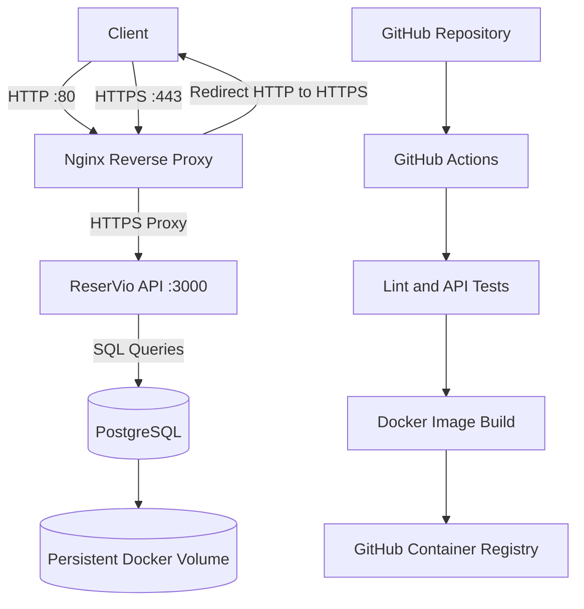

# ReserVio — Cloud-Native Hotel Reservation & Deployment Platform

ReserVio is a containerized hotel reservation API designed to demonstrate reliable application deployment, CI/CD automation, database persistence, reverse-proxy configuration, and operational recovery.

## 1. Technology Stack

- **Backend:** Node.js, Express
- **Database:** PostgreSQL 16
- **Containerization:** Docker, Docker Compose
- **Reverse Proxy:** Nginx
- **HTTPS:** TLS certificate for local testing
- **CI/CD:** GitHub Actions
- **Container Registry:** GitHub Container Registry (GHCR)
- **Testing:** Node.js test runner, Supertest
- **Code Quality:** ESLint

## 2. Architecture



## 3. Core Features

- API health endpoint.
- Database readiness endpoint.
- Room availability lookup using check-in, check-out, and room type.
- Reservation creation with unique booking references.
- Date validation.
- Prevention of overlapping confirmed reservations for the same room.
- PostgreSQL persistence.
- Repeatable room seed data.
- Dockerized API and database.
- Nginx reverse proxy with HTTP-to-HTTPS redirection.
- CI workflow for linting, testing, and Docker image publishing.

### Reservation concurrency protection

PostgreSQL uses a GiST exclusion constraint on room ID and reservation date ranges.

The date range uses `[)` semantics: check-in is inclusive and check-out is exclusive. This allows one reservation to check out on the same date another reservation checks in.

When a conflicting confirmed reservation is attempted, the API returns HTTP `409 Conflict`.

## 4. Project Structure

```text
ReserVio/
├── .github/
│   └── workflows/
│       └── ci.yml
├── database/
│   ├── schema.sql
│   └── seeds/
│       └── 001_rooms.sql
├── nginx/
│   └── conf/
│       └── default.conf
├── scripts/
│   └── concurrency-test.js
├── src/
│   ├── config/
│   │   └── database.js
│   ├── routes/
│   │   ├── rooms.js
│   │   └── reservations.js
│   ├── app.js
│   └── server.js
├── tests/
│   └── api.test.js
├── .dockerignore
├── .env.example
├── .gitignore
├── Dockerfile
├── docker-compose.yml
├── eslint.config.js
├── package.json
└── README.md
```

Local TLS certificates and database backups are intentionally excluded from version control.

## 5. Prerequisites

- Windows, Linux, or macOS
- Docker Desktop or Docker Engine with Docker Compose
- Node.js 22 or later for running tests on the host
- Git

## 6. Local Setup

Clone the repository:

```bash
git clone https://github.com/ParmandeepKaur/ReserVio.git
cd ReserVio
```

Create a local environment file:

```bash
cp .env.example .env
```

On Windows PowerShell, use:

```powershell
Copy-Item .env.example .env
```

Update the database password and connection string in `.env` if necessary.

Build and start the services:

```bash
docker compose up -d --build
```

Check container status:

```bash
docker compose ps
```

View logs:

```bash
docker compose logs -f
```

The API, database, and Nginx reverse proxy should start as separate services.

## 7. API Endpoints

| Method | Endpoint | Purpose |
|---|---|---|
| GET | `/api/health` | Application health |
| GET | `/api/ready` | Database readiness |
| GET | `/api/rooms/availability` | Search available rooms |
| POST | `/api/reservations` | Create a reservation |

The availability endpoint accepts check-in, check-out, and room type query parameters.

The reservation endpoint validates booking details and returns a unique booking reference when successful.

For exact request and response examples, refer to the route implementation and API tests.

## 8. Testing and Code Quality

Install dependencies:

```bash
npm ci
```

Run lint checks:

```bash
npm run lint
```

Run API tests:

```bash
npm test
```

Run both:

```bash
npm run check
```

The API tests cover health, readiness, invalid dates, invalid room types, reservation creation, and overlapping booking conflicts.

The separate concurrency test can be run with:

```bash
node scripts/concurrency-test.js
```

## 9. Docker and Deployment

Build the API image:

```bash
docker build -t reservio-api:1.0.0 .
```

Start the application:

```bash
docker compose up -d
```

Inspect services:

```bash
docker compose ps
```

Inspect API logs:

```bash
docker logs reservio-api
```

Inspect Nginx logs:

```bash
docker logs reservio-nginx
```

The API and database host ports are bound to loopback. Nginx exposes local HTTP and HTTPS ports on loopback.

### Local HTTPS

The Nginx configuration redirects HTTP traffic to HTTPS and forwards API requests to the backend.

For local testing with a self-signed certificate:

```powershell
curl.exe -I http://127.0.0.1
curl.exe -k https://127.0.0.1/api/health
curl.exe -k https://127.0.0.1/api/ready
```

The `-k` option is needed because the local certificate is self-signed. A production deployment requires a trusted certificate and appropriate domain configuration.

## 10. CI/CD Pipeline

The GitHub Actions workflow runs on pushes to `main`, version tags, and pull requests targeting `main`.

Pipeline stages:

1. Check out source code.
2. Set up Node.js.
3. Install dependencies.
4. Initialize PostgreSQL schema and seed data.
5. Run ESLint.
6. Run API tests.
7. Build the Docker image.
8. Publish the image to GHCR for non-pull-request events.

The image repository is:

```text
ghcr.io/parmandeepkaur/reservio
```

The workflow generates image tags using branch, commit SHA, and version tag metadata.

Workflow configuration: `.github/workflows/ci.yml`.

## 11. Database Backup and Restore

### Create a backup

```powershell
$backupFile = "backups\reservio-$(Get-Date -Format 'yyyyMMdd-HHmmss').dump"

docker exec reservio-db pg_dump -U reservio_user -d reservio_db -Fc -f /tmp/reservio.dump

docker cp reservio-db:/tmp/reservio.dump $backupFile
```

### Inspect a backup

```powershell
docker cp $backupFile reservio-db:/tmp/reservio-backup.dump

docker exec reservio-db pg_restore --list /tmp/reservio-backup.dump
```

### Restore into a separate test database

```powershell
docker exec reservio-db createdb -U reservio_user reservio_restore_test

docker exec reservio-db pg_restore -U reservio_user -d reservio_restore_test --no-owner --exit-on-error /tmp/reservio-backup.dump
```

Verify restored data:

```powershell
docker exec reservio-db psql -U reservio_user -d reservio_restore_test -c "SELECT COUNT(*) FROM rooms;"

docker exec reservio-db psql -U reservio_user -d reservio_restore_test -c "SELECT COUNT(*) FROM reservations;"
```

The restore procedure should be tested against a separate database before using it to recover a production database.

Backups contain application data and must be stored securely. They are excluded from Git.

## 12. Recovery and Rollback Runbook

### Restart services

```powershell
docker compose restart
```

### Inspect service health

```powershell
docker compose ps
docker compose logs --tail 100
```

### Rebuild and restart the application

```powershell
docker compose up -d --build api nginx
```

### Roll back to a previous application image

1. Identify the previously working image tag in GHCR.
2. Update the API image tag in `docker-compose.yml`.
3. Apply the configuration:

```powershell
docker compose up -d api nginx
```

4. Verify health and readiness:

```powershell
curl.exe -k https://127.0.0.1/api/health
curl.exe -k https://127.0.0.1/api/ready
```

Application rollback does not automatically reverse database schema changes. Database recovery must be handled separately using a verified backup and a planned restore procedure.

**Important:** Do not use `docker compose down -v` for routine recovery. It can delete persistent database volumes.

## 13. Security Practices

- Environment variables are used for database configuration.
- `.env` files are excluded from Git.
- TLS private keys and local certificates are excluded from Git.
- Database and API host ports are bound to loopback for local development.
- Nginx configuration and certificate mounts are read-only.
- The API Docker image runs as a non-root Node.js user.
- Helmet is used for HTTP security headers.
- PostgreSQL data is stored in a named persistent volume.
- GitHub Actions uses the GitHub-provided token for GHCR publishing.

Local self-signed HTTPS is intended for demonstration and testing, not public production use.

## 14. Verified Implementation Evidence

The following checks were performed during development:

- API lint and test command passed with 5 tests.
- Concurrent conflicting reservation requests resulted in one successful creation and one HTTP 409 response.
- Docker API and PostgreSQL containers reached healthy status.
- PostgreSQL backup was created and inspected.
- Backup was restored into a separate test database.
- Restored database contained six rooms and three reservations, with the overlap-prevention constraint present.
- GitHub Actions workflow completed successfully.
- Nginx returned HTTP 301 for HTTP requests.
- HTTPS health endpoint returned healthy status.
- HTTPS readiness endpoint confirmed database connectivity.

## 15. Repository

GitHub: https://github.com/ParmandeepKaur/ReserVio

**Project:** ReserVio — Cloud-Native Hotel Reservation & Deployment Platform